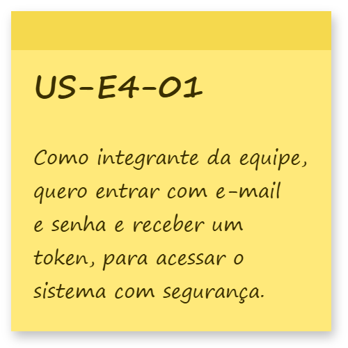
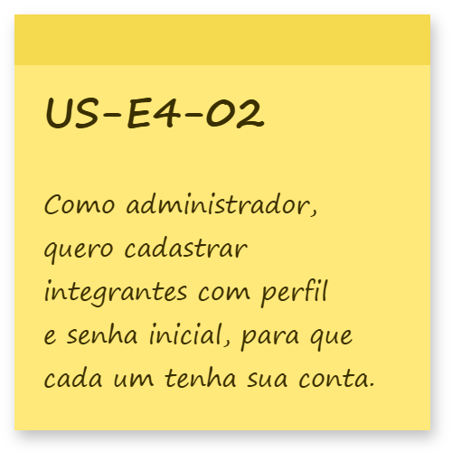
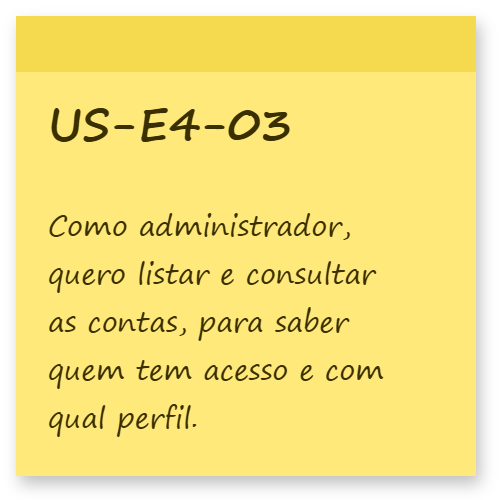
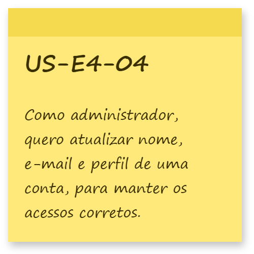
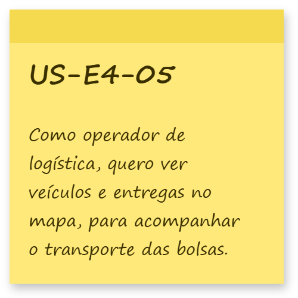
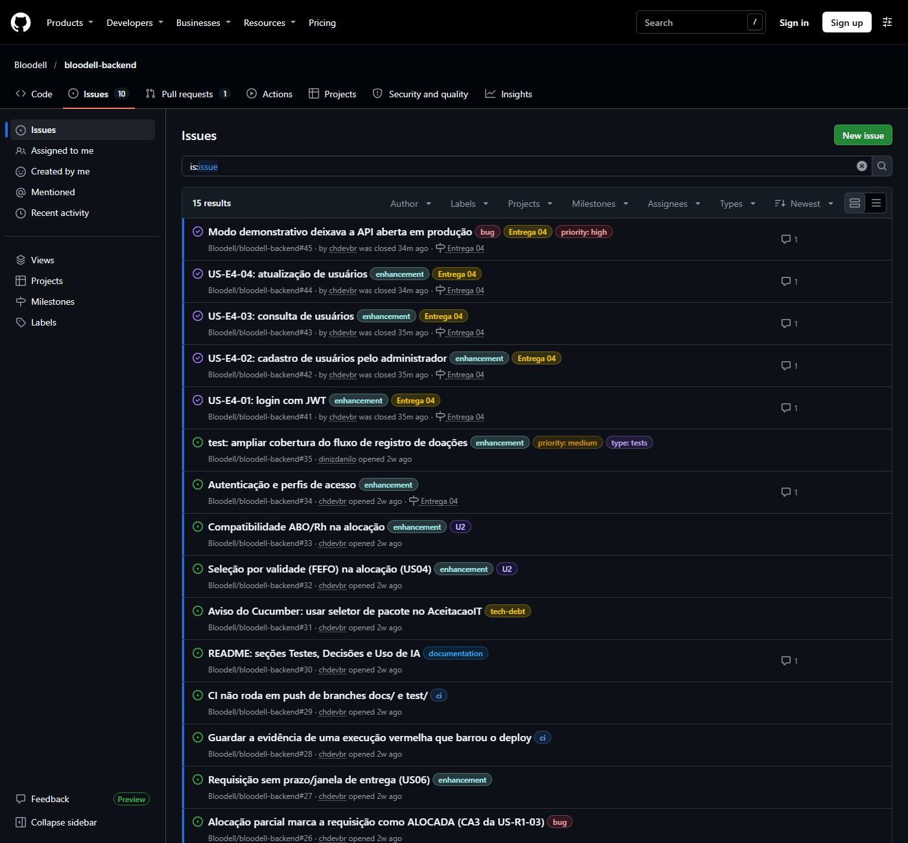
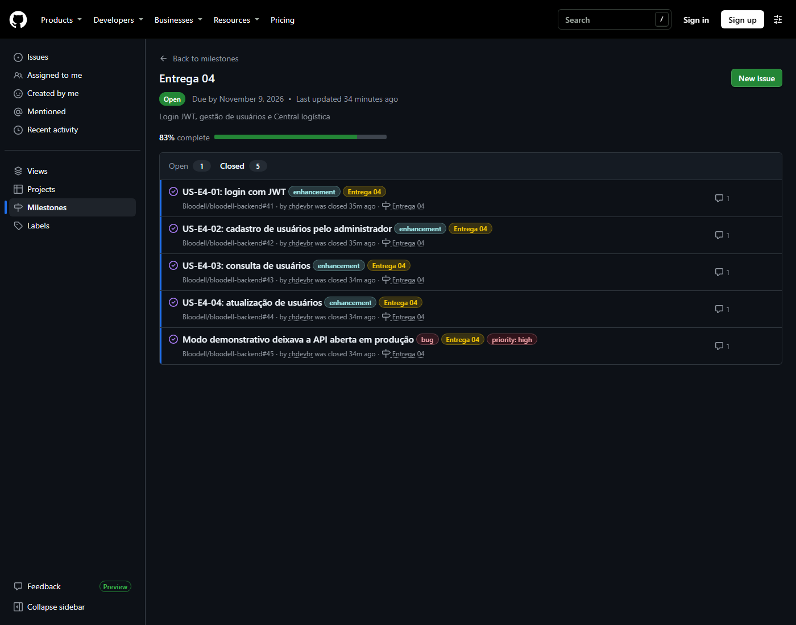

# Bloodell

> Plataforma para gestão, distribuição e monitoramento de hemocomponentes na rede de sangue.

## Sobre o projeto

O Bloodell é uma aplicação web desenvolvida para apoiar a gestão e distribuição de hemocomponentes na rede de sangue.

O sistema busca integrar diferentes etapas do processo, desde o gerenciamento de estoque e recebimento de requisições hospitalares até a alocação de bolsas compatíveis, priorização por validade (FEFO), roteirização de entregas e monitoramento da cadeia fria.

A solução é inspirada no fluxo da Hemorrede/SUS, contemplando centros de coleta e doação, hemocentros de processamento e controle, estoques e hospitais.

Todos os dados utilizados no projeto são sintéticos, não envolvendo informações reais de doadores ou pacientes.

> **Aviso:** a compatibilidade ABO/Rh implementada no projeto possui finalidade exclusivamente didática e não substitui protocolos clínicos ou sistemas oficiais da Hemorrede/SUS.

---

## Problema

A rede de sangue precisa garantir que o componente correto seja disponibilizado:

* para o paciente adequado;
* no hospital correto;
* dentro do tempo necessário;
* mantendo as condições adequadas de armazenamento e transporte.

Falhas nesse processo podem contribuir para desabastecimento, descarte de hemocomponentes por vencimento e dificuldades na distribuição.

O Bloodell busca centralizar essas informações e auxiliar na tomada de decisões relacionadas ao estoque, compatibilidade e distribuição.

---

## Solução

A plataforma será responsável por integrar:

* gestão de estoque de hemocomponentes;
* requisições hospitalares;
* compatibilidade ABO/Rh;
* priorização por validade utilizando FEFO (First Expired, First Out);
* roteirização de entregas;
* monitoramento da cadeia fria;
* simulação de localização e telemetria;
* indicadores de estoque e demanda.

---

## Arquitetura

O projeto está dividido em dois repositórios independentes:

```text
                    Bloodell
                       │
             ┌─────────┴─────────┐
             │                   │
             ▼                   ▼
          Front-end           Back-end
             │                   │
             │                   │
             └─────── API ───────┘
                         │
                         ▼
                   Banco de Dados
```

### Back-end

Desenvolvido em Java com Spring Boot, responsável pela API REST, regras de negócio, processamento dos dados e comunicação com o banco de dados.

Repositório: [Bloodell Backend](https://github.com/Bloodell/bloodell-backend)

### Front-end

Interface responsável pela interação dos usuários com o sistema e consumo da API disponibilizada pelo back-end.

Repositório: [Bloodell Frontend](https://github.com/Bloodell/bloodell-frontend)

---

## Tecnologias

### Back-end

* Java
* Spring Boot
* API REST (padrão `/api/v1`)
* Maven
* Spring Data JPA

### Front-end

* Next.js (React)
* TypeScript
* Tailwind CSS e componentes no padrão shadcn/ui
* MapLibre (mapa da Central logística)

### Banco de dados

* PostgreSQL

### Infraestrutura

* Docker e Docker Compose
* GitHub Actions (CI/CD)
* Nginx (proxy reverso com TLS na borda pública)

### Ferramentas

* Git
* GitHub

---

## Entregas

### Entrega 01

**Data:** 31/08
**Status:** Concluído

**Descrição:** levantamento das histórias de usuário do projeto, claras, concisas e completas, com detalhes de negócio na descrição e cenários de validação em BDD.

**Artefatos**

* Documentação: [Histórias de Usuário](https://github.com/gabrielgandrade/Bloodell_Historias_De_Usuario)
* Documentação: [Personas](https://github.com/gabrielgandrade/Bloodell_Personas)
* Protótipo Lo-Fi: [Figma](https://www.figma.com/make/LA6ILypFBbqo9QBfuR6eeG/High-Fidelity-Web-App-Prototype?code-node-id=0-6&fullscreen=1)

### Entrega 02

**Data prevista:** 21/09
**Status:** A definir

**Descrição:** a definir.

**Artefatos**

* [Documentação](#)
* [Apresentação](#)
* [Screenshots](#)
* [Outros artefatos](#)

### Entrega 03

**Data:** 19/10 (prorrogada para 23/10)
**Status:** Concluída

**Descrição:** implementação de ponta a ponta de duas histórias de usuário da Entrega 01, a **US05** e a **US06**: API REST com PostgreSQL, telas na interface web e testes automatizados (unitários, de integração e de aceitação em Gherkin). Tudo roda em container e é publicado automaticamente na AWS a cada merge na `main`.

**Sistema no ar:** [https://34.235.158.105](https://34.235.158.105) · [saúde da API](https://34.235.158.105/actuator/health)

#### Histórias implementadas

<p align="center">
  

  
</p>

##### US05 · Visualizar e controlar o estoque

> **Como** Técnico de Hemoterapia, **quero** visualizar as bolsas disponíveis organizadas por tipo sanguíneo e hemocomponente **para** acompanhar a situação do estoque e identificar necessidades de reposição ou riscos de vencimento.
>
> 🔴 Must Have · Persona: Técnico de Hemoterapia

| Cenário BDD (Entrega 01) | Como foi atendido | Onde ver |
| --- | --- | --- |
| Visualização do estoque | A doação registrada gera as bolsas, com validade calculada por componente, e elas entram no estoque. As bolsas podem ser consultadas com filtro por status, componente e unidade | Telas **Doações** e **Estoque** · `POST /api/v1/doacoes` · `GET /api/v1/bolsas` |
| Agrupamento por tipo sanguíneo e hemocomponente | O resumo do estoque soma as bolsas por unidade, tipo sanguíneo e hemocomponente | Tela **Estoque** · `GET /api/v1/estoques` |
| Bolsas próximas do vencimento | Cada bolsa mostra quantos dias faltam para vencer, ou há quantos dias venceu | Tela **Estoque** (“vence em X dia(s)”) |

**Testes:** [`FabricaDeBolsasTest`](https://github.com/Bloodell/bloodell-backend/blob/main/src/test/java/br/edu/cesar/bloodell/bolsa/FabricaDeBolsasTest.java) e `BolsaTest` (unitários), `CadastrosIT` (integração com PostgreSQL) e [3 cenários Gherkin](https://github.com/Bloodell/bloodell-backend/blob/main/src/test/resources/aceitacao/us-r1-01-registrar-doacao.feature) executados contra a API real.

##### US06 · Criar e acompanhar requisições

> **Como** profissional responsável pelas solicitações hospitalares, **quero** registrar uma requisição de hemocomponentes informando quantidade e prioridade **para** que o hemocentro possa organizar o atendimento da necessidade do hospital.
>
> 🔴 Must Have · Persona: Profissional Responsável pelas Solicitações Hospitalares

| Cenário BDD (Entrega 01) | Como foi atendido | Onde ver |
| --- | --- | --- |
| Criação da requisição | A requisição é registrada com hospital, tipo sanguíneo, hemocomponente, quantidade e prioridade, e entra na fila com status `NA_FILA` (pendente) | Tela **Requisições** · `POST /api/v1/requisicoes` |
| Organização por prioridade | A fila atende EMERGÊNCIA, depois URGENTE, depois ELETIVA; na mesma prioridade, vale a ordem de chegada. A fila é uma estrutura de dados feita à mão (AED), espelhada em C | Tela **Requisições** · `GET /api/v1/requisicoes/fila` |
| Acompanhamento da requisição | A consulta mostra o status atual (`NA_FILA` → `ALOCADA` → `EM_ROTA` → `ATENDIDA`). Enquanto está na fila, a prioridade pode ser alterada e o pedido pode ser cancelado | `GET · PUT · DELETE /api/v1/requisicoes/{id}` |

**Testes:** `FilaRequisicoesTest` e `AlocacaoProvisoriaU1Test` (unitários), `FluxoDaUnidadeUmIT` (integração com PostgreSQL) e [8 cenários Gherkin](https://github.com/Bloodell/bloodell-backend/tree/main/src/test/resources/aceitacao) de requisição e alocação.

**Fora desta entrega:** o prazo/janela de entrega da requisição e a autenticação dos perfis ([ADR-004](https://github.com/Bloodell/bloodell-backend/blob/main/docs/adr/ADR-004-autenticacao-fora-do-mvp.md)) ficam para as próximas entregas.

#### Screencasts

| Vídeo | Link |
| --- | --- |
| 🎬 Sistema funcionando: as novas histórias na interface | [YouTube](https://youtu.be/Yp17E9dM5S4?si=YXsrLUCkMDtjM0Lk) |
| 🎬 Explicação do código das histórias implementadas | [YouTube](https://youtu.be/wv1onbPYYUY?si=n-0Utz8xnUSnZDPM) |

#### Versionamento

* Fluxo de trabalho: uma branch por tarefa → pull request → `dev` → `main`, com `dev` e `main` protegidas (CI verde e 1 aprovação para o merge).
* Histórico: [commits do backend](https://github.com/Bloodell/bloodell-backend/commits/main) · [pull requests](https://github.com/Bloodell/bloodell-backend/pulls?q=is%3Apr+is%3Amerged) · [execuções da esteira](https://github.com/Bloodell/bloodell-backend/actions).
* Cada merge na `main` testa, empacota e publica o sistema na AWS ([primeiro deploy automático](https://github.com/Bloodell/bloodell-backend/actions/runs/39865307872), em 22/10).

#### Issue tracker

As tarefas e os bugs em aberto ficam nas [issues do backend](https://github.com/Bloodell/bloodell-backend/issues).

<p align="center">
  
</p>

**Artefatos**

* [Story map da Release 1](https://github.com/Bloodell/bloodell-backend/blob/main/docs/story-map-release-1.md)
* [Rastreabilidade: tarefas × testes](https://github.com/Bloodell/bloodell-backend/blob/main/docs/rastreabilidade-release-1.md)
* [Documentação da API (Swagger)](https://34.235.158.105/swagger-ui.html)
* [Evidências de execução](https://github.com/Bloodell/bloodell-backend/tree/main/docs/evidencias/e1)

### Entrega 04

**Data:** 09/11
**Status:** Concluída

**Descrição:** acesso seguro ao sistema e gestão das contas da equipe — login com JWT, cadastro, consulta e atualização de usuários pelo administrador, e JWT obrigatório em produção — além da **Central logística** no frontend, com mapa de rastreamento das entregas e nova identidade visual.

#### Histórias implementadas

<p align="center">
  
  
  
  
  
</p>

##### US-E4-01 · Entrar no sistema (login JWT)

> **Como** integrante da equipe do hemocentro ou do hospital, **quero** entrar com e-mail e senha e receber um token **para** acessar o sistema de forma identificada e segura.

| Critério de aceite | Como foi atendido | Onde ver |
| --- | --- | --- |
| Login devolve token com validade | Senha conferida com BCrypt; resposta traz `accessToken`, `expiresIn` e o perfil | `POST /api/v1/auth/login` |
| Credencial errada não revela o motivo | E-mail inexistente, senha errada ou conta sem hash válido respondem o mesmo 401 | `AutenticacaoIT` |
| Perfil sempre atualizado | `/auth/me` reconsulta o banco em vez de confiar no token | `GET /api/v1/auth/me` |
| API protegida | Com a autenticação ligada, toda rota de negócio exige `Bearer`; em produção ela é obrigatória (PR #39) | `AutenticacaoProducaoIT` |

##### US-E4-02 · Cadastrar integrantes

> **Como** administrador, **quero** cadastrar integrantes com nome, e-mail, perfil e senha inicial **para** que cada pessoa tenha sua própria conta.

| Critério de aceite | Como foi atendido | Onde ver |
| --- | --- | --- |
| Só ADMIN cadastra | Sem token → 401; outro perfil → 403 | `POST /api/v1/usuarios` |
| E-mail único | E-mail repetido (ignorando maiúsculas) → 409 | `CadastroDeUsuarioIT` |
| Resposta segura | 201 com id, nome, e-mail e perfil — nunca senha ou hash | [contrato](https://github.com/Bloodell/bloodell-backend/blob/dev/docs/cadastro-usuarios-card-4.md) |

##### US-E4-03 · Consultar contas

> **Como** administrador, **quero** listar e consultar as contas **para** saber quem tem acesso e com qual perfil.

| Critério de aceite | Como foi atendido | Onde ver |
| --- | --- | --- |
| Lista paginada | Até 100 por página, ordem fixa por ID | `GET /api/v1/usuarios?page=&size=` |
| Consulta por ID | Conta inexistente → 404; parâmetro inválido → 400 | `GET /api/v1/usuarios/{id}` · `ConsultaDeUsuarioIT` |

##### US-E4-04 · Atualizar contas

> **Como** administrador, **quero** atualizar nome, e-mail e perfil de uma conta **para** manter os acessos corretos.

| Critério de aceite | Como foi atendido | Onde ver |
| --- | --- | --- |
| Atualização parcial | Campos omitidos são mantidos; senha e ID não mudam | `PATCH /api/v1/usuarios/{id}` |
| Sempre resta um administrador | Rebaixar o último ADMIN → 409, inclusive com duas atualizações simultâneas | `AtualizacaoDeUsuarioIT` |
| Efeito imediato | O login aceita o novo e-mail e as permissões seguem o perfil novo | [contrato](https://github.com/Bloodell/bloodell-backend/blob/dev/docs/atualizacao-usuarios-card-6.md) |

##### US-E4-05 · Central logística (mapa de rastreamento)

> **Como** operador de logística, **quero** ver no mapa os veículos e as entregas em andamento **para** acompanhar o transporte dos hemocomponentes.

| Critério de aceite | Como foi atendido | Onde ver |
| --- | --- | --- |
| Mapa das entregas | Mapa MapLibre com hemocentros, hospitais e caminhões em 3D | Tela **Central logística** (`/rastreamento`) |
| Dados reais da API | Entregas, unidades, requisições e veículos vêm da API, com estados de carregando, erro e vazio | `use-rastreamento.ts` |
| Trajeto e posição | Rota pelas estradas (ou curva estimada, se o serviço de rotas falhar); posição pela telemetria ou estimada pelo tempo previsto | `rotas.ts`, `posicao.ts` |

**Fora desta entrega:** tela de login no frontend e permissões por perfil nas demais rotas ([issue #34](https://github.com/Bloodell/bloodell-backend/issues/34)).

#### Screencasts

| Vídeo | Link |
| --- | --- |
| 🎬 Sistema funcionando: as novas histórias | _em breve_ |
| 🎬 Explicação do código das histórias implementadas | _em breve_ |

#### Versionamento

* Mesmo fluxo da Entrega 03: branch por tarefa → pull request revisado → `dev` → `main`.
* Commits no período: 30/10 (login JWT, PR #36), 31/10 (gestão de usuários, PR #38), 04/11 (redesign e Central logística, frontend PR #2), 06/11 (JWT em produção, PR #39).
* Histórico: [commits do backend](https://github.com/Bloodell/bloodell-backend/commits/dev) · [commits do frontend](https://github.com/Bloodell/bloodell-frontend/commits/main) · [pull requests](https://github.com/Bloodell/bloodell-backend/pulls?q=is%3Apr).

#### Issue tracker

Tarefas e bugs nas [issues do backend](https://github.com/Bloodell/bloodell-backend/issues), com rótulos (`bug`, `enhancement`, `tech-debt`, `ci`, `U2`, `Entrega 04`) e template de bug report. O milestone [Entrega 04](https://github.com/Bloodell/bloodell-backend/milestone/1) reúne uma issue por história (#41–#44) e o bug de segurança corrigido (#45), todas fechadas pelos PRs que as implementaram; a US-E4-05 está na [issue #3 do frontend](https://github.com/Bloodell/bloodell-frontend/issues/3).

<p align="center">
  
</p>

<p align="center">
  
</p>

**Artefatos**

* [Documentação da Entrega 04](https://github.com/Bloodell/bloodell-backend/blob/dev/docs/entrega-04.md)
* Contratos: [login JWT](https://github.com/Bloodell/bloodell-backend/blob/dev/docs/autenticacao-jwt-card-1.md) · [cadastro](https://github.com/Bloodell/bloodell-backend/blob/dev/docs/cadastro-usuarios-card-4.md) · [consulta](https://github.com/Bloodell/bloodell-backend/blob/dev/docs/consulta-usuarios-card-5.md) · [atualização](https://github.com/Bloodell/bloodell-backend/blob/dev/docs/atualizacao-usuarios-card-6.md)

---

## Contexto acadêmico

O Bloodell é um projeto interdisciplinar que integra conhecimentos de diferentes áreas do curso.

Entre as principais competências trabalhadas estão:

* programação orientada a objetos;
* desenvolvimento de APIs REST;
* estruturas de dados;
* grafos e caminhos mínimos;
* filas de prioridade;
* hash;
* compatibilidade e matching;
* estatística descritiva;
* probabilidade;
* concorrência;
* CI/CD;
* computação em nuvem;
* arquitetura de redes;
* telemetria;
* trabalho em equipe e integração entre áreas.

---

## Limitações e cuidados

* O projeto utiliza exclusivamente dados sintéticos.
* Não serão utilizadas informações reais de pacientes ou doadores.
* A telemetria de temperatura e GPS será simulada.
* A compatibilidade ABO/Rh possui finalidade exclusivamente didática.
* O sistema não substitui protocolos médicos ou sistemas oficiais.
* Não haverá integração com sistemas oficiais da Hemorrede/SUS.
* O grafo utilizado para roteirização terá tamanho limitado.
* As condições da cadeia fria serão simuladas para fins acadêmicos.

---

## Equipe

| Nome             | E-mail CESAR School                           | Função |
| ---------------- | --------------------------------------------- | ------ |
| Alisson Santana  | [ass6@cesar.school](mailto:ass6@cesar.school) | Scrum Master |
| Arthur Abelardo  | [aacc@cesar.school](mailto:aacc@cesar.school) | Desenvolvedor |
| Carlos Henrique  | [chcf@cesar.school](mailto:chcf@cesar.school) | Desenvolvedor |
| Danilo Diniz     | [dgds@cesar.school](mailto:dgds@cesar.school) | Desenvolvedor |
| Gabriel Andrade  | [gga3@cesar.school](mailto:gga3@cesar.school) | Product Owner |
| Roberto Henrique | [rhcf@cesar.school](mailto:rhcf@cesar.school) | Analista de requisitos e testes (QA) |

---

## Repositórios

| Repositório           | Descrição                                    |
| ---------------------- | --------------------------------------------- |
| Bloodell               | Página principal e documentação do projeto    |
| [Bloodell Backend](https://github.com/Bloodell/bloodell-backend)   | API e regras de negócio em Java/Spring Boot   |
| [Bloodell Frontend](https://github.com/Bloodell/bloodell-frontend) | Interface web da aplicação                    |

---

## Licença

A definir.
